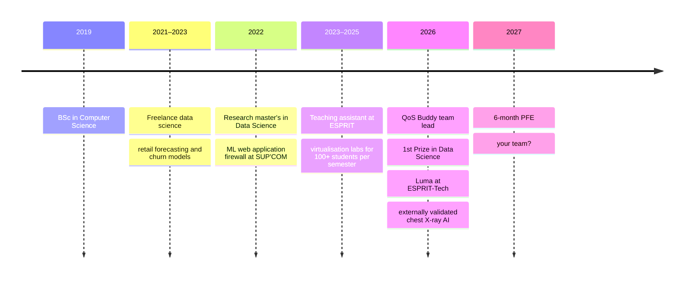

 

## 🚀 Featured work

<table>
<tr>
<td width="50%"></td>
<td width="50%"></td>
</tr>
<tr>
<td align="center"><a href="https://youtu.be/d6H16-UNWZ4">▶ Watch the Luma demo</a></td>
<td align="center"><a href="https://youtu.be/hh9mBwo952o">▶ Watch the QoS Buddy demo</a></td>
</tr>
</table>

## 🧭 How I work

| Principle | Where you can see it |
|---|---|
| **Lock first, test second.** A model is fixed before it sees its external test set. | Luma's model was chosen on CheXpert, then tested once on 14,250 untouched VinBigData images. |
| **Report what I didn't prove.** Every result comes with its limits and confidence intervals. | The Luma model card and the QoS Buddy README both disclose their caveats openly. |
| **Ship it like software.** Models arrive with tests, CI and verified artefacts. | 90 tests and a SHA-256-verified ONNX release in Luma; 98 test cases and CI in the QoS Buddy optimizer. |
| **Security is a feature.** Sensitive data is encrypted, audited and minimised by design. | Luma uses RBAC, AES-GCM encryption, HMAC-chained audit logs, and sends no images out unless the user opts in. |

## 🧰 Toolbox

**Machine learning** 

**LLMs and agents** 

**Engineering and MLOps** 

## 🛤️ The path so far

### 📬 Building AI that has to work outside the notebook?

I'm looking for a **6-month end-of-studies internship (PFE) in applied AI or ML engineering**, starting from
**January 2027 in Tunisia** or **April 2027 in Europe**. ESPRIT provides the internship agreement.
I speak Arabic, French and English.

