<b>📬 <a href="mailto:hassani.amani@esprit.tn?subject=PFE%202027%20opportunity">hassani.amani@esprit.tn</a> · <a href="https://www.linkedin.com/in/amani-hassani/">LinkedIn</a> · available from January 2027, flexible start, Tunisia or abroad</b>

<a href="https://youtu.be/d6H16-UNWZ4">▶ Watch the Luma demo</a> · <a href="https://github.com/Amani-hassani/luma-cxr">Explore the repo</a>

<a href="https://youtu.be/hh9mBwo952o">▶ Watch the QoS Buddy demo</a> · <a href="https://github.com/Amani-hassani/Esprit-PIDS-4DS4-2026-QOS_Buddy">Explore the repo</a>

<b><a href="mailto:hassani.amani@esprit.tn?subject=PFE%202027%20opportunity">✉ Book the flight: hassani.amani@esprit.tn</a> · <a href="https://www.linkedin.com/in/amani-hassani/">LinkedIn</a></b>

