



**[01 · The refusal](#stop-01)** &nbsp;·&nbsp; **[02 · Six agents](#stop-02)** &nbsp;·&nbsp; **[03 · How I build](#stop-03)** &nbsp;·&nbsp; **[04 · The road here](#stop-04)** &nbsp;·&nbsp; **[05 · Your team](#stop-05)**

 


<table>
<tr>
<td width="50%" valign="top"><a href="https://github.com/Amani-hassani/luma-cxr"></a></td>
<td width="50%" valign="top"> ▶ <b>Watch the Luma demo</b></td>
</tr>
</table>

<b>🔬 Peek inside Luma</b>

 

Occlusion evidence: each box shows how the score moved when that region was hidden, and whether all three models agreed. It is not a lesion detector, and the app says so.

 



<table>
<tr>
<td width="50%" valign="top"><a href="https://github.com/Amani-hassani/Esprit-PIDS-4DS4-2026-QOS_Buddy"></a></td>
<td width="50%" valign="top"> ▶ <b>Watch the QoS Buddy demo</b></td>
</tr>
</table>

 



<b>🧰 Full toolbox</b>

 

**Machine learning:**      

**LLMs and agents:**     

**Engineering and MLOps:**          

 


 

<a href="mailto:hassani.amani@esprit.tn?subject=PFE%202027%20opportunity"></a>

**Building AI that has to work outside the notebook? Let's talk.** 
ESPRIT provides the internship agreement for placements in Tunisia and abroad.

